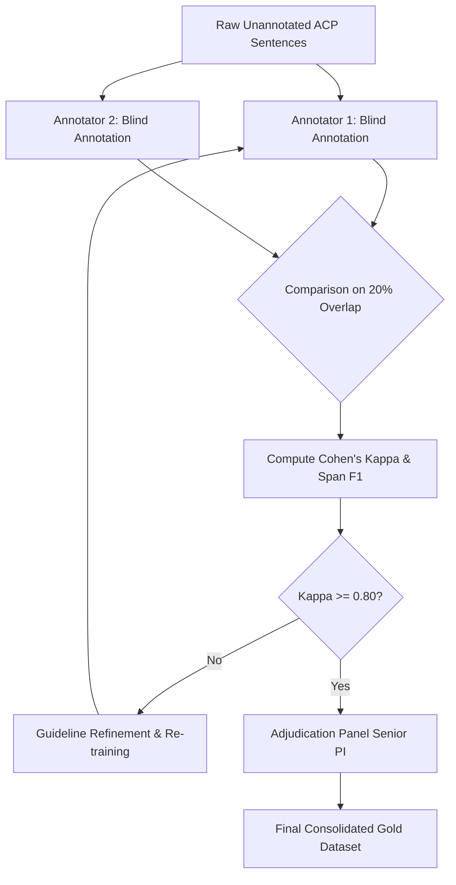

# ABAC Policy Annotation Protocol & Quality Assurance Specification

**Document Version:** 2.0  
**Date:** September 2026  
**Project:** NLACP-AttributeExtractor (Automated Attribute Extraction from Natural Language ABAC Policies)  
**Schema Compliance:** ABAC Policy Schema v2.0 (`data/schema_v2.0.json`)

---

## 1. Overview and Scope

This protocol specifies the annotation schema, boundary criteria, quality assurance procedures, and scientific integrity standards used to construct and validate the ground-truth ("Gold Standard") datasets for the NLACP-AttributeExtractor benchmark.

### 1.1 Datasets Covered

| Dataset | Domain | Sentence Count ($N$) | Primary Entity Types | Gold Standard File |
| :--- | :--- | :---: | :--- | :--- |
| **VACT** | University IT & Academic Management | 100 | User, Student, Lecturer, Academic System, Grade, Course | `outputs/policies/vact_gold.json` |
| **iTrust** | Electronic Healthcare Records | 53 | Patient, Physician, HCP, Medical Record, Prescription | `outputs/policies/itrust_gold.json` |
| **eDocument**| Enterprise Document Management | 85 | Manager, Clerk, Document, Approval, Workflow | `outputs/policies/edocument_gold.json` |

---

## 2. Target ABAC Schema (Schema v2.0)

All annotations conform to `data/schema_v2.0.json`. Each policy object is structured with the following core components:

```json
{
  "id": 1,
  "sentence": "Civilian students can view their own final grades in the academic information system for courses which they have taken.",
  "authorization_decision": "permit",
  "policy_modality": "can",
  "subjects": [
    {
      "entity_type": "user",
      "role": "student",
      "qualifiers": { "type": "civilian", "rank": null, "status": null, "office": null, "department": null, "negated": false }
    }
  ],
  "actions": [
    { "verb": "view", "operation": "READ", "negated": false }
  ],
  "resource": {
    "entity_type": "data",
    "label": "grade",
    "qualifier": "the",
    "attributes": null
  },
  "environments": [
    {
      "env_type": "system",
      "trigger_phrase": "the academic information system",
      "trigger_word": "in"
    }
  ],
  "context": [
    {
      "type": "relational",
      "trigger_phrase": "for courses which they have taken",
      "formal_expression": "resource.course_id IN subject.enrolled_courses"
    }
  ]
}
```

### 2.1 Element Definitions and Boundaries

1. **Subject (`subjects`)**:
   - **Role / Entity Type**: The actor authorized or prohibited (e.g., `student`, `lecturer`, `physician`).
   - **Qualifiers / Attributes**: Modifiers distinguishing subject categories (e.g., `type: civilian`, `rank: chair`, `office: academic affairs`).
2. **Action (`actions`)**:
   - **Matrix Verb**: The principal operation granted to the subject (e.g., `view`, `modify`, `download`).
   - **Canonical Operation**: Standardized CRUD classification (`READ`, `UPDATE`, `CREATE`, `DELETE`, or domain-specific verbs).
3. **Resource / Object (`resource` / `resources`)**:
   - **Core Label**: The target data asset or physical resource accessed (e.g., `grade`, `medical_record`, `document`).
   - **Qualifier**: Relational ownership or scope (e.g., `own`, `all`, `patient's`).
   - **Attributes**: Inherent resource states (e.g., `status: closed`, `status: open`, `status: issued`).
4. **Environment (`environments`)**:
   - **Temporal, Spatial, or System conditions** under which access is evaluated.
   - Must be triggered by explicit prepositional phrases (`in <system>`, `between <time>`, `from <location>`).
5. **Context & Preconditions (`context`)**:
   - Adverbial or relative clauses expressing prerequisite conditions (e.g., `"if it has been validated and exported"`, `"for courses which they teach"`).

---

## 3. Historical Annotation Process (Current Benchmark v2.0)

> [!IMPORTANT]
> **Scientific Integrity & Truthful Disclosure:**  
> The ground-truth datasets for VACT ($N=100$), iTrust ($N=53$), and eDocument ($N=85$) were annotated by a **single domain-expert annotator (ThS. Nguyễn Đức Hiếu)** utilizing an interactive AI-assisted workflow. **No dual independent annotation or inter-annotator majority voting was conducted for this release**, and no Cohen's Kappa metric is claimed for the historical v2.0 benchmark.

### 3.1 Round 1: Initial Annotation and AI-Assisted Drafting
- **Draft Generation**: Initial candidate spans were generated by the automated NLP pipeline (`nlacp` extraction modules).
- **Interactive Verification**: The primary annotator reviewed each candidate sentence using CLI verification tools (`scripts/interactive_verification.py` and `scripts/interactive_annotator.py`).
- **Manual Corrections**:
  - Corrected inaccurate entity spans (e.g., distinguishing object boundaries from attached prepositional phrases).
  - Assigned correct subject role hierarchies and department/office qualifiers.
  - Normalized actions and mapped negative modalities (`cannot`, `must not` $\rightarrow$ `deny`).

### 3.2 Round 2: Quality Assurance and Schema Harmonization
- **Single-Expert Audit**: The primary annotator conducted a complete review pass over all annotated policies to resolve inconsistencies and enforce uniformity across the 3 datasets.
- **Automated Schema Validation**: All JSON outputs were validated against `data/schema_v2.0.json` to guarantee strict syntactic and structural compliance.
- **Sanitization of Legacy Issues**:
  - Legacy circular validation in the experimental University dataset was detected and completely purged on 2026-09-14 (see `CHANGELOG_GOLD.md`).
  - Separation between experimental utilities (`fix_vact_gold.py`, `auto_annotate_gold.py`) and authoritative gold files was strictly preserved: scratch scripts were never applied to the committed repository ground truth.

### 3.3 Acknowledged Limitations
1. **Single Annotator**: Without a second independent annotator for the current 238 policy sentences, empirical Inter-Annotator Agreement (IAA) cannot be computed.
2. **Grammatical Articles as Qualifiers**: In early iterations of VACT gold annotation, English determiners/articles (`the`, `a`) were entered into the resource qualifier field in 57 instances. As documented in our evaluation specification, these are automatically neutralized by stopword filtering in `unified_eval.py` (`STOPWORDS = {"a", "an", "the"}`) so that only genuine semantic qualifiers (`own`, `all`, status) affect benchmark scores.

---

## 4. Annotation Rules & Disambiguation Guidelines

To maintain consistency during ongoing dataset maintenance and future expansion, annotators must adhere to the following disambiguation rules:

### Rule 1: Separation of Resource and Environmental Boundaries
Prepositional phrases indicating systems, locations, or operational environments must **not** be absorbed into the resource noun phrase.
- **Incorrect**: `Object = "final grades in the academic information system"`
- **Correct**: `Object = "final grades"`, `Environment = "in the academic information system"`

### Rule 2: Preconditions vs. Permitted Actions
Verbs appearing in subordinate condition clauses (`advcl`) describe prerequisite document or system states, **not** permissions granted to the actor.
- *Example (Policy ID 93)*: *"The registrar may issue the diploma if it has been numbered, validated, and exported."*
- **Incorrect**: `Actions = ["issue", "number", "validate", "export"]`
- **Correct**: `Actions = ["issue"]`, `Context = ["if it has been numbered", "validated", "exported"]`

### Rule 3: Distinguishing Determiners from Semantic Qualifiers
Grammatical articles (`the`, `a`, `an`) must **never** be annotated as qualifiers or attributes.
- **Incorrect**: `Resource Qualifier = "the"`
- **Correct**: `Resource Qualifier = null` (unless a semantic modifier such as `own`, `all`, or a possessive is present).

### Rule 4: Passive Voice and Actor Resolution
When policies are formulated in passive voice without a grammatical subject (e.g., *"Medical summaries may only be accessed by the attending physician"*), the agent phrase (`by ...`) must be resolved as the **Subject**, not the grammatical patient.

---

## 5. Protocol for Future Dataset Expansion (Target: 500+ Sentences)

To address peer-reviewer recommendations regarding dataset scale and inter-annotator reliability (`REVIEWER_RESPONSES.md`, Q7), future expansions of the VACT benchmark (from 100 to 500+ policies) will strictly follow the **Dual Independent Annotation Protocol**:



### 5.1 Protocol Specifications
1. **Annotator Independence**: Two independent annotators with background in software engineering and access control will annotate an overlapping 20% random sample (minimum 100 sentences) under blinded conditions.
2. **Agreement Metrics**:
   - Categorical attribute assignment (Decision, Modality, CRUD operation): **Cohen's Kappa ($\kappa$)** must satisfy:
     $$\kappa \ge 0.80 \quad (\text{Substantial to Near-Perfect Agreement})$$
   - Entity span boundaries (Subject, Resource, Environment spans): **Token-level Span $F_1 \ge 0.85$**.
3. **Adjudication**: Any inter-annotator divergence will be arbitrated by a designated senior researcher / Principal Investigator (PI) through a documented consensus meeting.
4. **Version Control**: Every revision to the gold corpus will be logged with timestamp, rationale, and policy ID in `CHANGELOG_GOLD.md`.

---

## 6. Evaluation Criteria Alignment

The benchmark evaluation script (`scripts/unified_eval.py`) measures system performance against this protocol under two formal evaluation modes:

1. **Strict Evaluation (Exact-Match)**:
   - Span matching requires exact string equality after lowercase conversion, singularization, and stopword removal.
   - Action verbs require exact lemma match.
2. **Relaxed Evaluation (Semantic Overlap)**:
   - Resource and Environment spans are matched using token-level Jaccard overlap ($\text{IoU} \ge 0.60$).
   - Action verbs are matched using canonical operation synonym groups (`ACTION_SYNONYM_GROUPS`).
